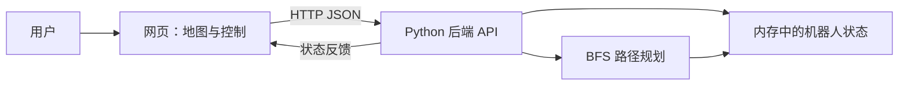

# 巡迹：Web 智能巡检机器人二维仿真

一个面向编程初学者的课程项目：在网页中手动控制机器人，或让它使用广度优先搜索（BFS）依次访问三个巡检点并显示路线。纯软件仿真，无需真实机器人和第三方 Python 包。

**在线演示：尚未部署。** 部署成功后，请将真实访问地址写在这里。

## 功能

- 12 × 8 网格、固定障碍物、三个巡检点和机器人位置。
- 方向键或按钮控制；障碍物、边界阻挡与状态反馈。
- 模拟电量随步数下降，前方距离显示上方到障碍或边界之间的空格数；这些数值并非真实传感器。
- 自动巡检：依次前往 1、2、3 号点；可停止、手动接管或重置。
- Python HTTP API、基础自动测试、GitHub Actions 配置与 Dockerfile。

## 运行

安装 Python 3.10 或更新版本，在本目录执行：

```bash
python server.py
```

浏览器打开 http://localhost:8000 。按 Ctrl+C 停止。若端口被占用，可设置环境变量 `PORT` 后重新启动。服务端静态文件路径以程序位置为准。

运行测试：`python -m unittest discover -v`。

Docker（需要先安装并启动 Docker）：

```bash
docker build -t patrol-sim .
docker run --rm -p 8000:8000 patrol-sim
```

然后打开同一地址。此环境未检测到 Docker，容器构建和运行尚未验证。

## 架构



GET `/api/state` 返回地图和状态。POST `/api/action` 接受 `{"action":"move","direction":"up"}`、`{"action":"step","target":0}` 或 `{"action":"reset"}`。自动巡检的定时器在网页中，每次请求后端规划并走一步；关闭页面后不会继续自动巡检。状态保存在服务器内存中，重启会重置，所有访问者共享同一台机器人。该演示服务没有账号、鉴权或持久化，不适合直接用于公开生产环境。

## 文件与提交

`server.py` 是后端和 BFS；`static/` 是网页；`test_server.py` 是测试；`test_http.py` 是 HTTP 集成测试；`.github/workflows/ci.yml` 是 CI 配置；`Dockerfile` 用于容器化。请阅读 [学习与展示指南](GUIDE.md)。

本地 Git 仓库用于版本管理；远程仓库：[hr28an/patrol-sim](https://github.com/hr28an/patrol-sim)。在线部署和 CI 运行结果需以实际验证为准。项目由 AI 辅助生成；请根据实际学习、修改和分工如实填写贡献，不要把未完成的工作写成自己的成果。

## 验证记录（2026-11-21）

- Python 3.14：6 项单元及 HTTP 集成测试通过，覆盖障碍、路线、错误请求、三个巡检点及复位。
- 浏览器：实际点击验证手动移动、自动巡检三个点和复位；JavaScript 语法检查通过。
- 本机未检测到 Docker，容器构建和运行尚未在本机验证。CI 已配置测试、镜像构建与容器健康检查，尚未在 GitHub 上运行。
- 在线演示尚未部署；远程 CI 结果以 GitHub Actions 实际运行记录为准。

## 对照考核目标

| 范围 | 项目现状 |
| --- | --- |
| 基础版 | Web 页面、后端 API、二维地图、手动控制、状态反馈、本地 Git、CI 和 Docker 配置 |
| 标准版选做 | BFS 路径规划、自动巡检与路线显示；附模拟距离和电量 |
| 待完成 | 在有 Docker 的环境验证；验证 GitHub CI；按要求部署、制作截图或录屏；填写真实个人贡献 |

更多操作、讲解和展示准备见 [学习与展示指南](GUIDE.md)。
